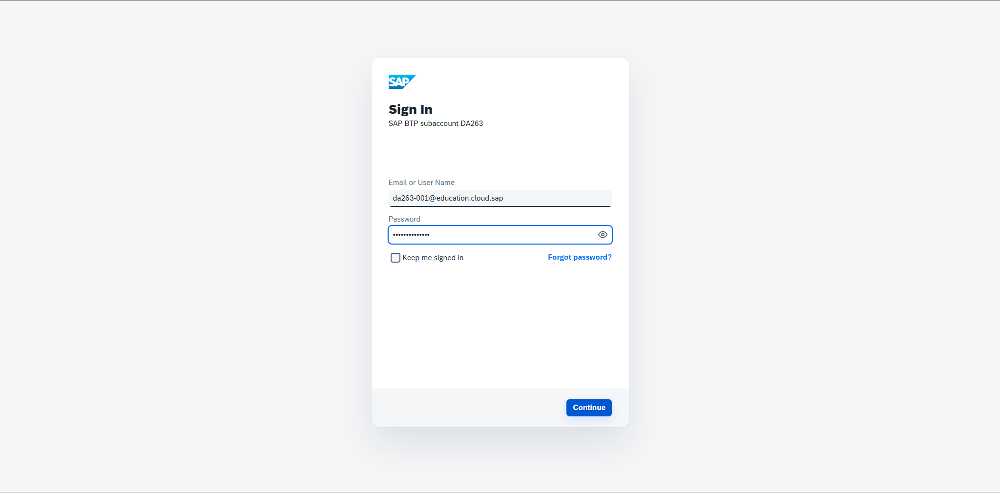
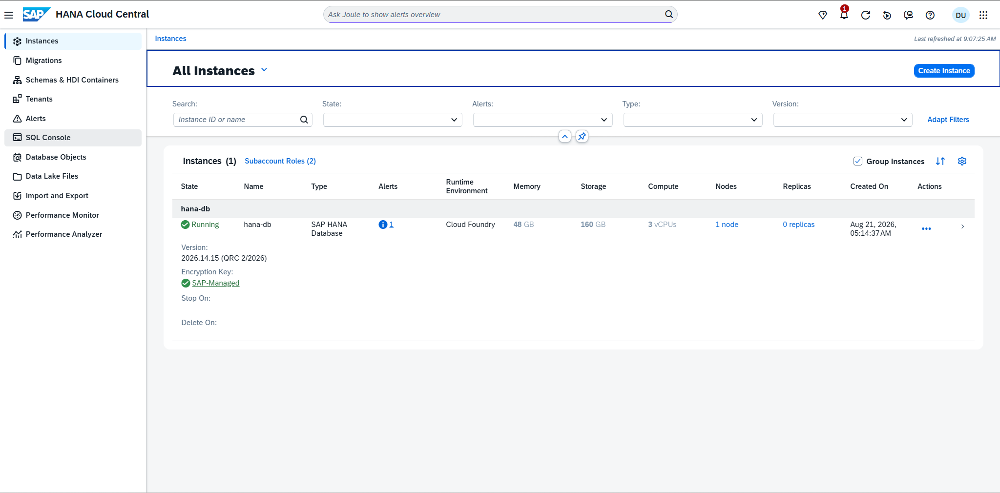
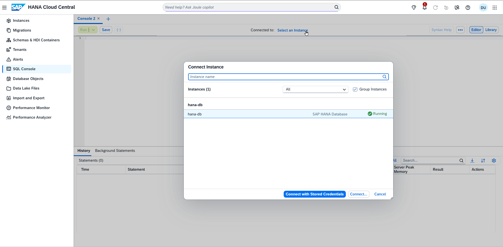
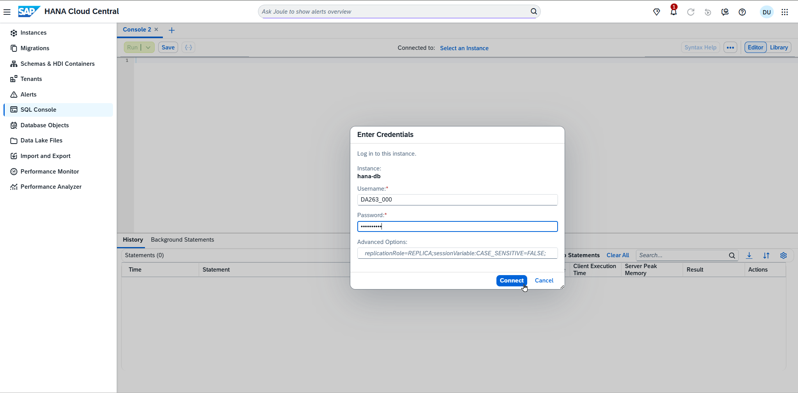

# Log In to SAP BTP and Open SAP HANA Cloud Central

We will use SAP HANA Cloud Central for exercises 1 and 2.

Open a browser and point to https://da263.hana-tooling.ingress.orchestration.prod-eu10.hanacloud.ondemand.com/ and sign in with
 **Username** `da263-000@education.cloud.sap` (replace 000 with your student number, e.g. 001)
 **Password** `Acce$$teched26`

Choose **SQL Console** on the left panel and click on `Select an Instance `.
 Select `hana-db` and connect with
 **Username** `DA263_000` (replace 000 with your student number, e.g. 001)
 **Password** `welCome!26`

## Summary

You are connected to the SAP HANA Cloud database via the SQL Console.

Continue to - [Exercise 1 - SAP HANA Cloud AI features](../ex1/README.md)
