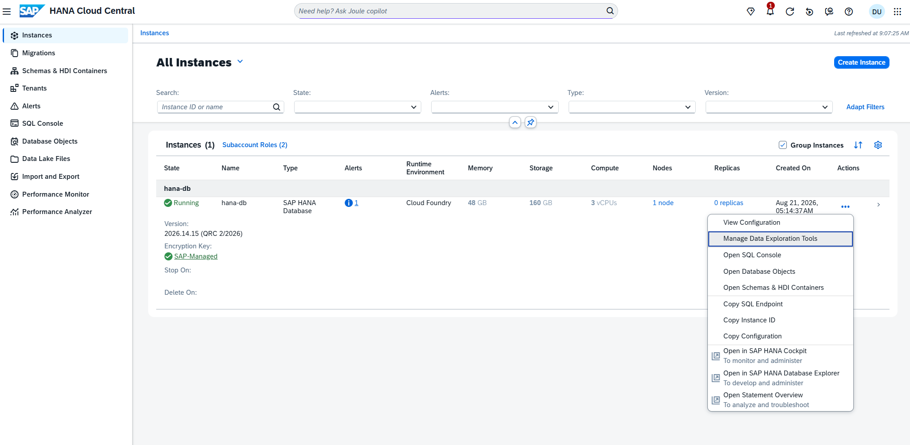
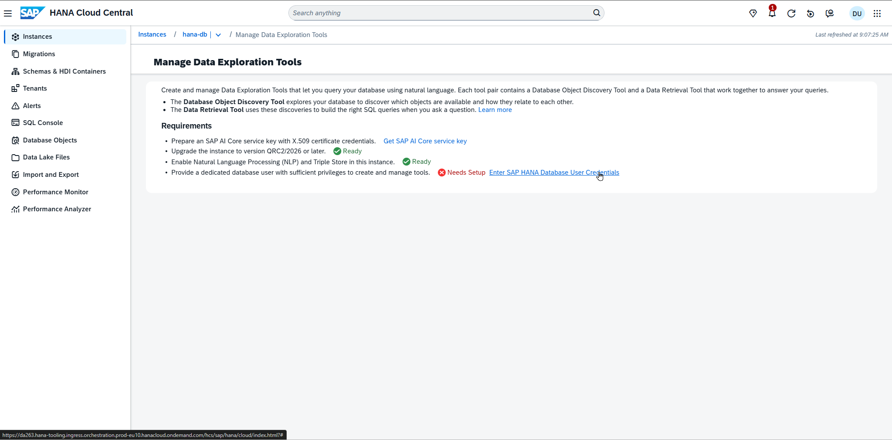
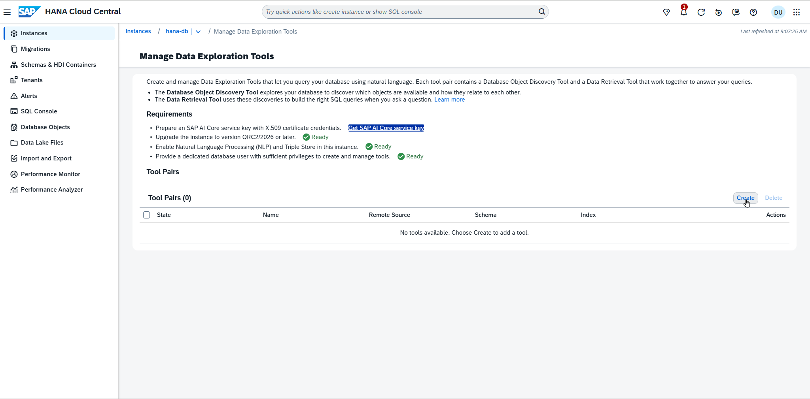
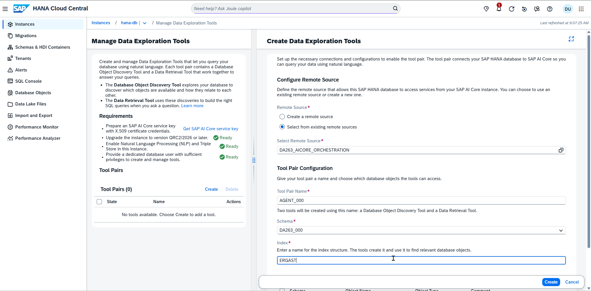
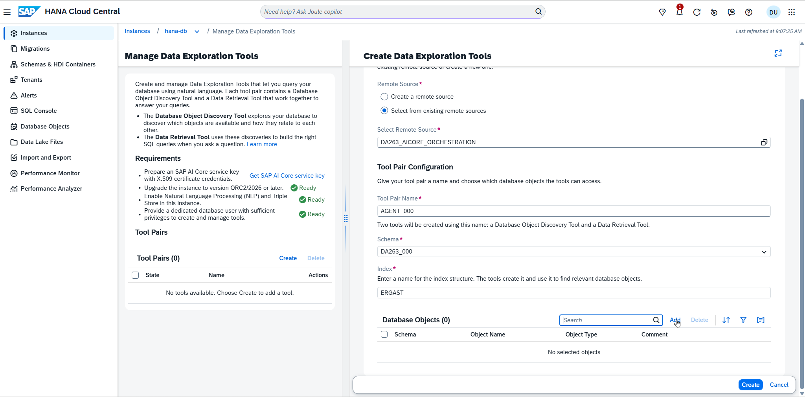
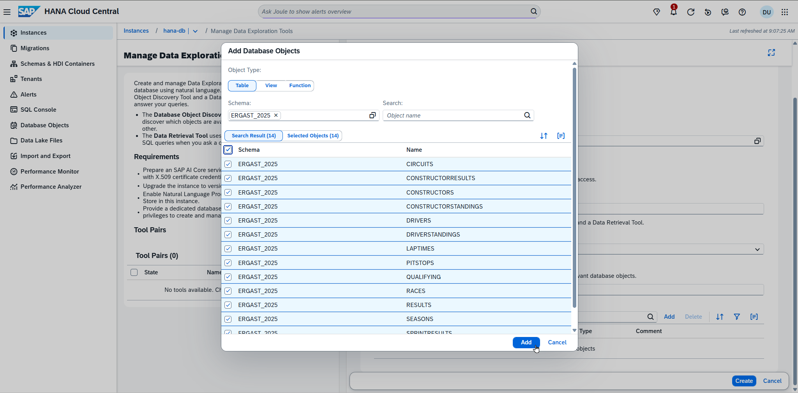
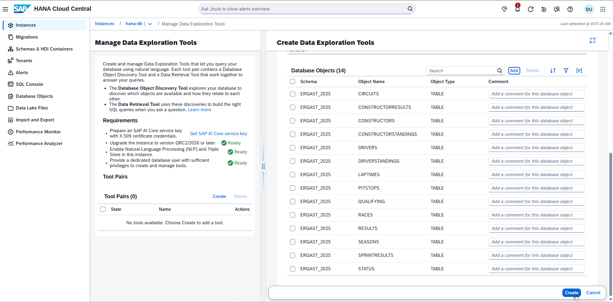
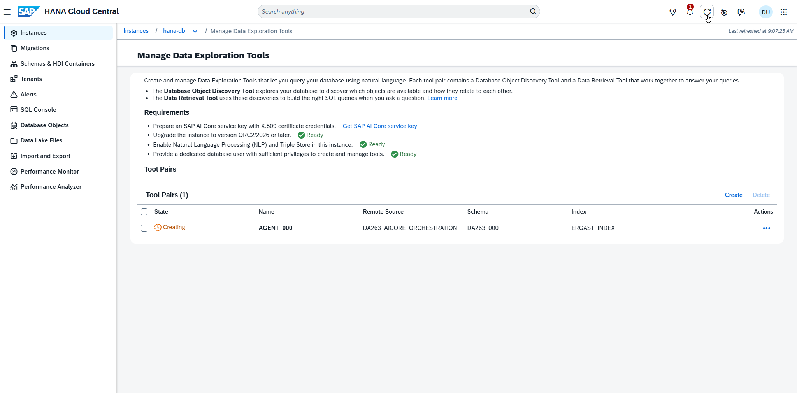
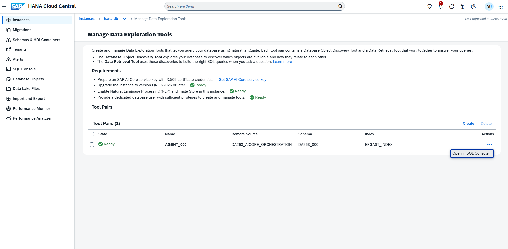
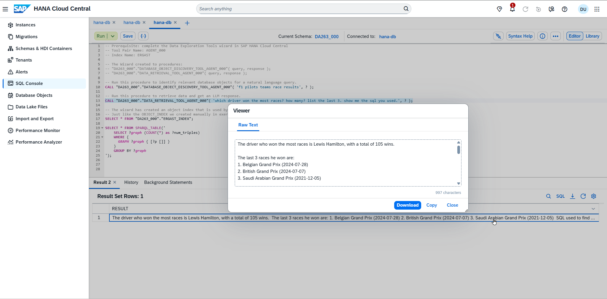

# Exercise 2 - Data Exploration Tools

In this exercise, we will use the `Data Exploration Tools` and complete a wizard which creates an object index similar to what we created manually in exercise 1. This object index is used by two generated database procedures:
- "DATABASE_OBJECT_DISCOVERY_TOOL"( query, response );
- "DATA_RETRIEVAL_TOOL"( query, response );

`DATABASE_OBJECT_DISCOVERY_TOOL` takes a natural language query and returns relevant database objects, including their descriptions and definitions.
`DATA_RETRIEVAL_TOOL` takes a natural language query, generates SQL statements, and returns a response grounded in the retrieved data.

## Open the Data Exploration Tools

Choose **Instances** on the left panel in SAP HANA Cloud Central, open the context menu (Click on the 3 dots ... under `Actions`) for your SAP HANA Cloud instance, and click on `Manage Data Exploration Tools`.

**If required**, enter your database credentials. Otherwise, just proceed.
 **Username** `DA263_000` (replace 000 with your student number, e.g. 001)
 **Password** `welCome!26`

Click on `Create` to define a new tool pair.

We will now create Data Exploration Tools using a wizard
- For `Remote Sources`, choose `Select from existing remote sources`.
- Select the remote source `DA263_AICORE_ORCHESTRATION` from the pick-list.
- Enter `AGENT_000` (replace 000 with your student number, e.g. 001) as Tool Pair Name.
- Make sure the suggested schema matches your user schema, e.g. `DA263_001`.
- Enter `ERGAST` as Index.

**Add** the database objects which should be exposed via the Data Exploration Tools.

Select all the tables in the `ERGAST_2025` schema and confirm the pop-up with **Add**.

Finally, click **Create** and wait for the creation process to finish.

Click **Refresh** in the upper right to update the status.

Once the Tool Pair is `Ready`, click on **Open in SQL Console**.

This brings up two examples on how to use the Data Exploration Tools via generated database procedures. You can now enter your natural language query and run the procedures
- e.g. 'which driver won the most races?'

**OR**

open the short SQL script [2026 Q3 TechEd 2026 DA263_000 Data Exploration Tools.sql](/SQL/2026%20Q3%20TechEd%202026%20DA263_000%20Data%20Exploration%20Tools.sql).

## Summary

We have used the Data Exploration Tools in SAP HANA Cloud Central to create an index of database objects. The wizard also generates two database procedures
- "DATABASE_OBJECT_DISCOVERY_TOOL"( query, response );
- "DATA_RETRIEVAL_TOOL"( query, response );

`DATABASE_OBJECT_DISCOVERY_TOOL` takes a natural language query and returns relevant database objects, including their descriptions and definitions.
`DATA_RETRIEVAL_TOOL` takes a natural language query, generates SQL statements, and returns a response grounded in the retrieved data.

Continue to - [Exercise 3 - Using SAP HANA Cloud via LangChain ](../ex3/README.md)
