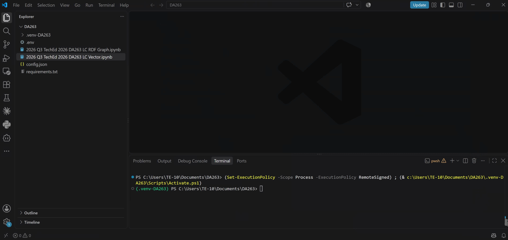

# Exercise 3 - Using SAP HANA Cloud via LangChain

In this exercise we will walk through three python Jupyter notebook. These notebooks run in Visual Studio Code.
1. Open Visual Studio Code on your machine (search for 'code' in Windows).
2. Click `File`, `Open Folder` and open 'tbd'

Open the .ipynb files in VS Code.

In exercise 3.1 we will connect to SAP HANA Cloud from python and expose the `OBJECT_INDEX` table we created in exercise 1 as a LangChain vector store.

In exercise 3.2 we will connect to our `OBJECT_INDEX_RDF_GRAPH` and let an LLM create SPARQL queries to retrive data from the graph.

In exercise 3.3 we will build a naive LangGraph agent (rather: a workflow) that glues togather the vector store, the RDF graph, and an LLM to provide natural-language-to-SQL (NL2SQL).

Continue to - [Exercise 3.1 - Work with SAP HANA Cloud Vector Engine from LangChain](../ex3/2026 Q3 TechEd 2026 DA263 LC Vector.ipynb)
