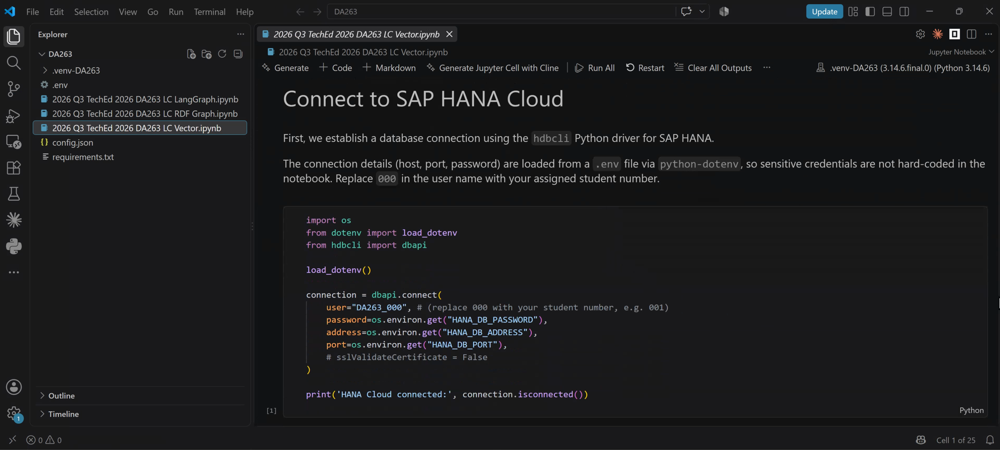

# Exercise 3 - Using SAP HANA Cloud via LangChain

In this exercise we will walk through three python Jupyter notebook. These notebooks run in Visual Studio Code.
1. Open Visual Studio Code on your machine (search for 'code' in Windows).
2. Click `File`, `Open Folder` and open 'C:\Software\DA263'
3. On the left side you see the project files. Open the ``2026 Q3 TechEd 2026 DA263 LC Vector.ipynb`` file.
4. In the right upper area you see 'Jupyter Kernels'. Select the one starting with **.venv-DA263** if it is not already selected.
5. Step through the notebook.

The notebooks contain explanations in markdown and python code blocks. The code blocks are executed by clicking on the small triangle on the left of the cell, or by clicking into the cell and hitting STRG+Enter.

Read and step through the notebooks in the following order:
1. `2026 Q3 TechEd 2026 DA263 LC Vector.ipynb`
2. `2026 Q3 TechEd 2026 DA263 LC RDF Graph.ipynb`
3. `2026 Q3 TechEd 2026 DA263 LC LangGraph.ipynb`

